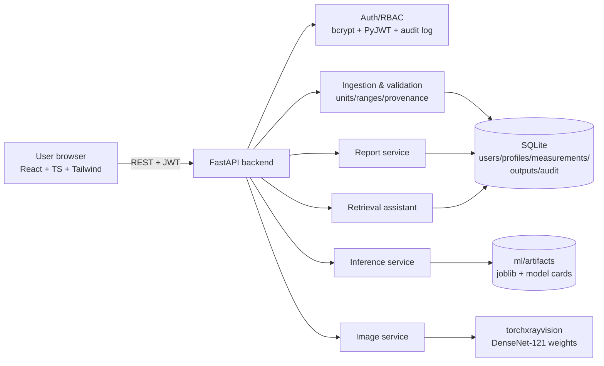
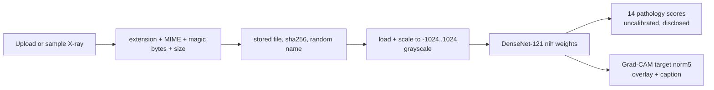
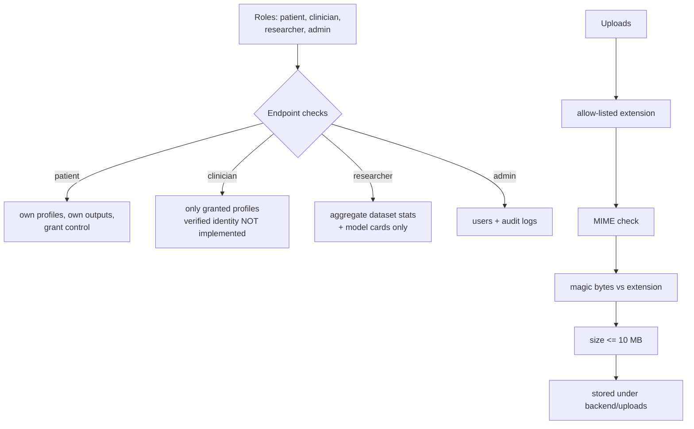

# HealthSignal — Architecture & Data Flow

## System overview



## Prediction pipeline (tabular)

```mermaid
flowchart TD
    subgraph training (offline, deterministic seed 42)
        D[public dataset] --> P1[stratified 70/30 split]
        P1 --> T[train split]
        T --> CV[5-fold stratified CV<br/>LR / RF / HistGB / LightGBM<br/>scored by ROC-AUC, PR-AUC]
        CV --> SEL[best pipeline refit on train]
        SEL --> TE[held-out test split:<br/>ROC-AUC, PR-AUC, F1, sens, spec,<br/>Brier, confusion matrix]
        SEL --> ART[ml/artifacts/model.joblib<br/>+ model_card.json]
    end
    subgraph serving
        F[feature form from model card] --> C[coerce + range check<br/>missing stays missing]
        C --> X[DataFrame aligned to<br/>training column order]
        X --> ART
        X --> SH[SHAP / linear SHAP]
    end
```

## Image pipeline



## Security boundaries



## Multimodal decision (honest framing)

HealthSignal deliberately does **not** fuse incompatible model outputs into one "risk score". Modality
integration is at the dashboard/report level: each specialised model keeps its own provenance, dataset, metrics
and caveats; the unified dashboard aggregates *information*, not probabilities. Fusion of calibrated,
compatible outputs is listed as future work in the technical report.